<p align="center">
  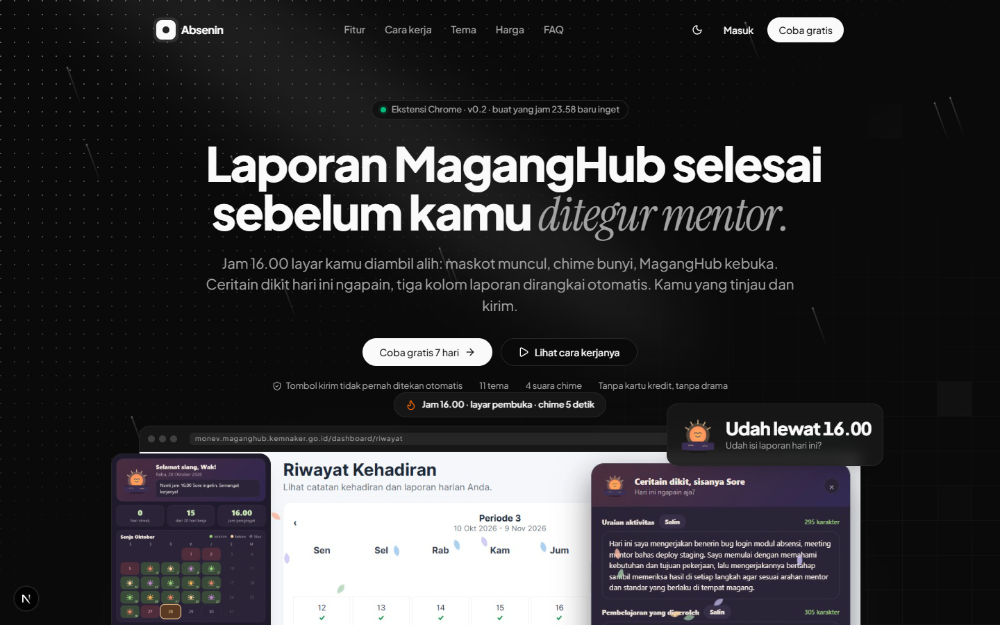
</p>

<h1 align="center">Absenin</h1>

<p align="center">
  Pengingat laporan harian MagangHub yang nggak bisa dicuekin, plus tiga kolom laporan dirangkai dari cerita singkatmu.<br>
  Ekstensi Chrome + web (landing, dashboard, admin, API). <b>Tombol kirim tetap kamu yang tekan.</b><br>
  <sub>Bukan produk Kemnaker atau MagangHub. Dibuat oleh peserta magang, untuk peserta magang.</sub>
</p>

<p align="center">
  <a href="#cara-kerja">Cara kerja</a> ·
  <a href="#fitur">Fitur</a> ·
  <a href="#tema">Tema</a> ·
  <a href="#pasang-ekstensi">Pasang ekstensi</a> ·
  <a href="#jalankan-web">Jalankan web</a> ·
  <a href="#arsitektur">Arsitektur</a> ·
  <a href="#api">API</a> ·
  <a href="#keamanan">Keamanan</a>
</p>

---

## Masalah yang diselesaikan

Peserta MagangHub wajib mengisi laporan harian: uraian aktivitas, pembelajaran, dan kendala, masing-masing minimal 100 karakter, di hari yang sama. Jam 16.00 energi sudah habis, laporan ditunda, lalu lupa, lalu besoknya mentor yang nagih.

Absenin menyelesaikannya dalam dua menit:

1. **Jam 16.00** Chrome dibawa ke depan dan fullscreen. Layar pembuka muncul (maskot, kelopak jatuh, chime 5 detik), lalu halaman Riwayat MagangHub kebuka. Kalau belum diisi, diulang tiap 10 menit sampai beres.
2. **Ceritain dikit.** Klik tanggal hari ini, panel ikut kebuka. Ketik satu baris, tap chip kegiatan, atau tebak dari riwayat Chrome. Pilih gaya laporan.
3. **Baca, centang, kirim sendiri.** Tiga kolom terisi dan bisa diedit. Ekstensi tidak pernah menekan Simpan dan Kirim.

## Cara kerja

| Langkah 1: layar pembuka | Langkah 2: panel cerita |
|---|---|
| 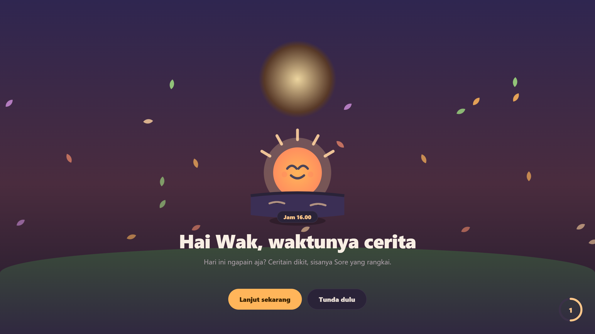 | 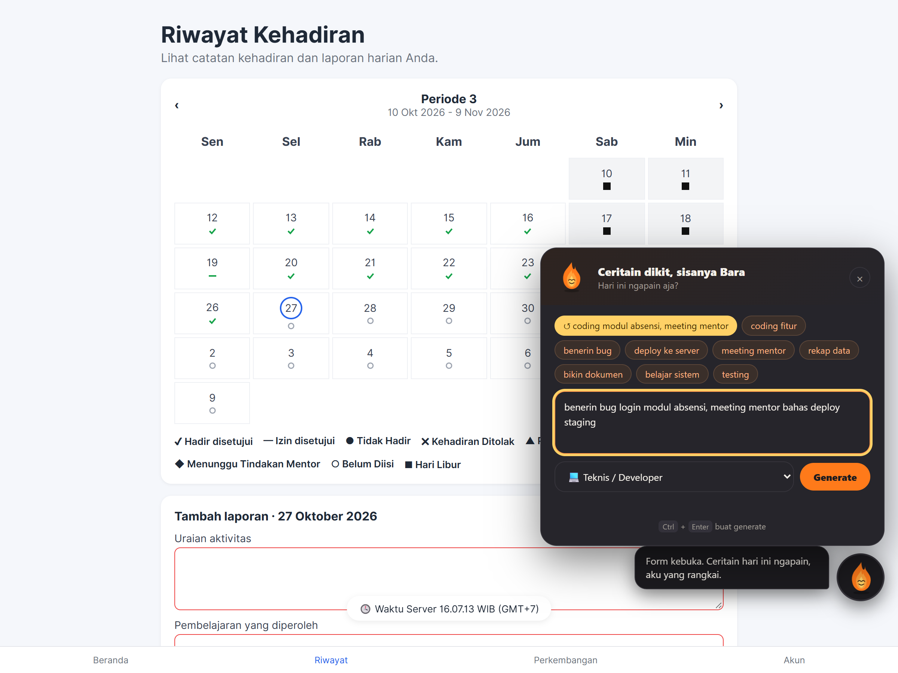 |

| Langkah 3: tiga kolom terisi, kamu yang kirim |
|---|
| 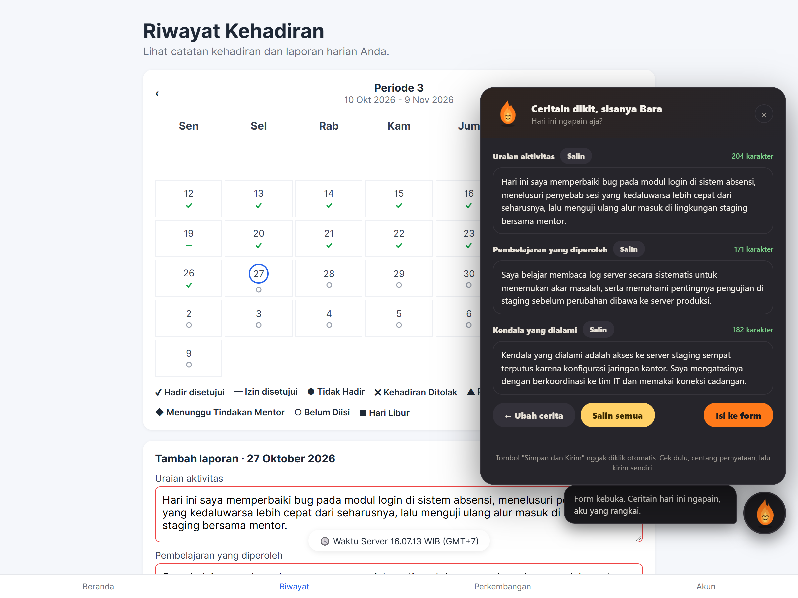 |

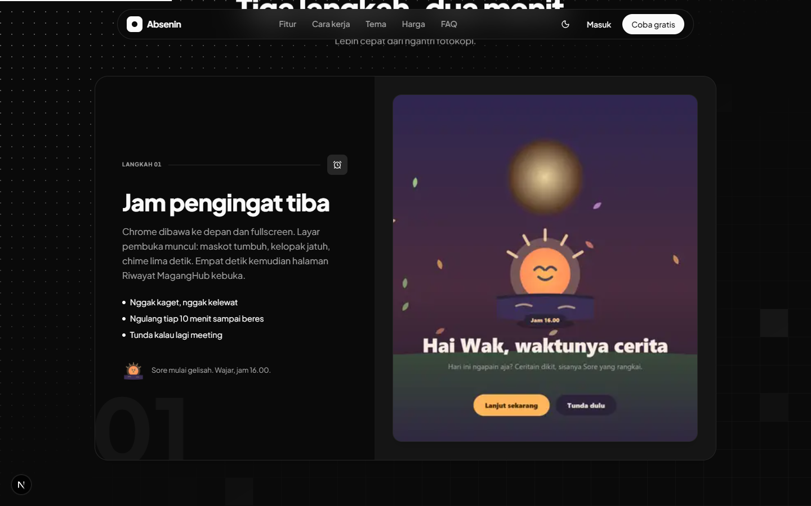

## Fitur

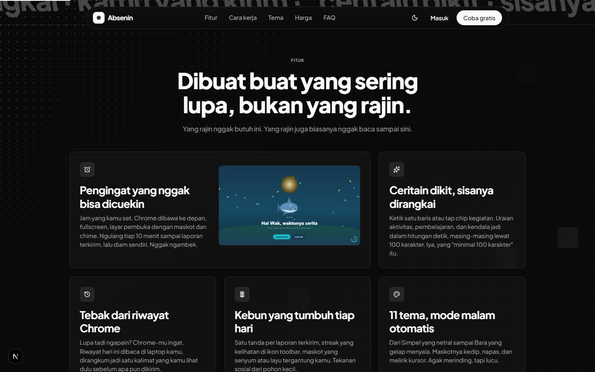

- **Pengingat yang nggak bisa dicuekin.** Alarm harian Senin sampai Jumat, notifikasi Windows dengan tombol "Isi sekarang" dan "Tunda", Chrome fullscreen, layar pembuka, chime. Berhenti sendiri begitu laporan hari itu terkirim.
- **Generate dari cerita singkat.** Satu baris jadi tiga paragraf 160 sampai 320 karakter. Enam gaya bawaan (Teknis, Analis Data, Administrasi, Rapat, Desain, Riset) plus gaya buatan sendiri. Tiga laporan terakhir dikirim sebagai konteks supaya kalimatnya nggak berulang.
- **Tebak dari riwayat Chrome.** Opsional. Riwayat hari ini dibaca di laptop, dikelompokkan (GitHub, Google Sheets, Canva, meeting, hosting), dan ditaruh sebagai satu kalimat yang kamu lihat dulu sebelum apa pun dikirim.
- **Kebun dan streak.** Satu tanda per laporan terkirim di popup, angka streak di ikon toolbar (hijau beres, oranye belum), maskot yang senyum atau layu.
- **12 tema, mode malam otomatis, 4 suara chime.** Maskot hidup: kedip, napas, nguap kalau malam, melirik kursor.
- **Alt+M** dari tab mana pun membuka MagangHub plus panel. **Ctrl+Enter** untuk generate.
- **Panduan pertama kali** empat langkah dan pengaturan lima tab yang nggak kayak kokpit pesawat.
- **Task Scheduler Windows** supaya Chrome dibuka otomatis pada jam pengingat walau sedang ditutup.
- **Telemetri anonim opsional**: deteksi kalender gagal, generate error, versi lama. Supaya kami tahu kalau MagangHub berubah tampilan.

## Tema

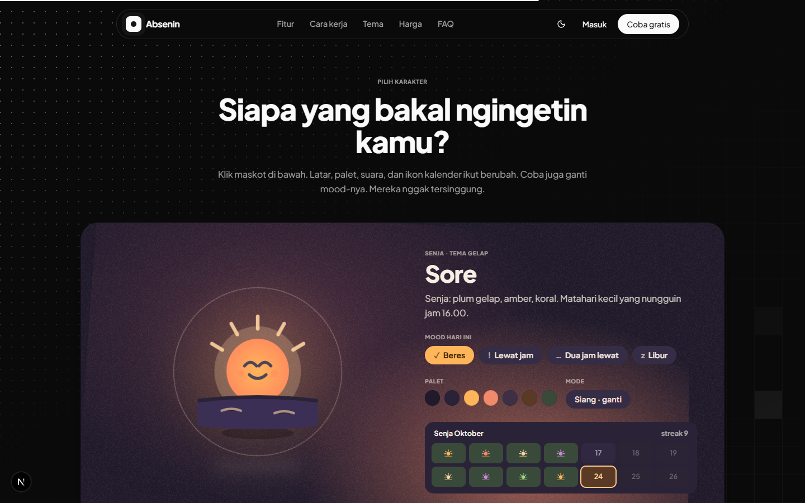

| Sore (default) | Bara | Robo |
|---|---|---|
| 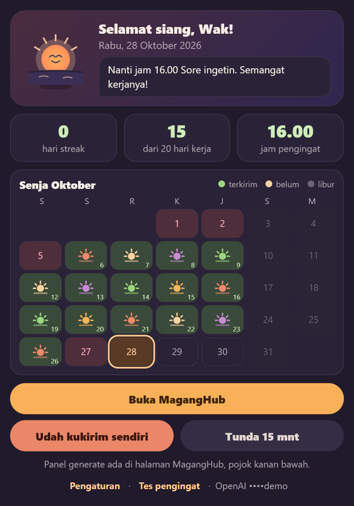 | 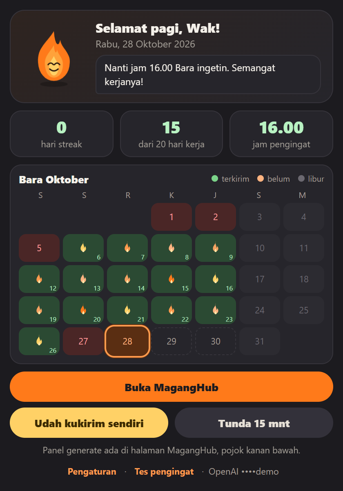 | 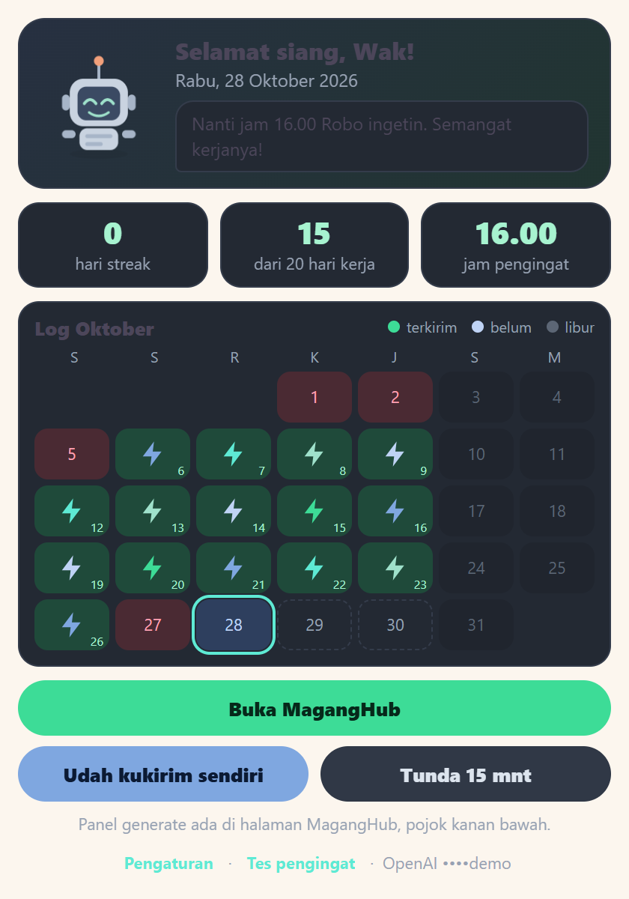 |

| Astro | Hiu | Harimau |
|---|---|---|
| 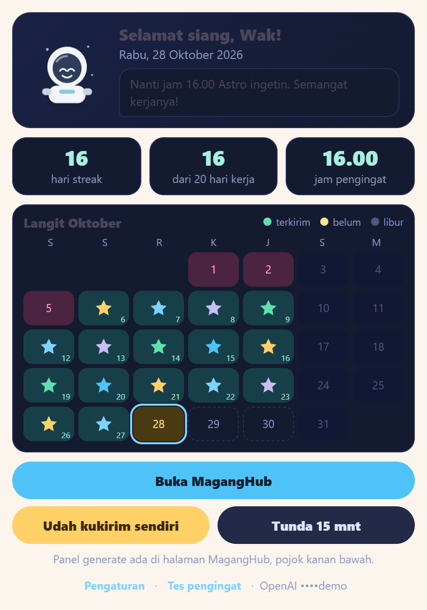 | 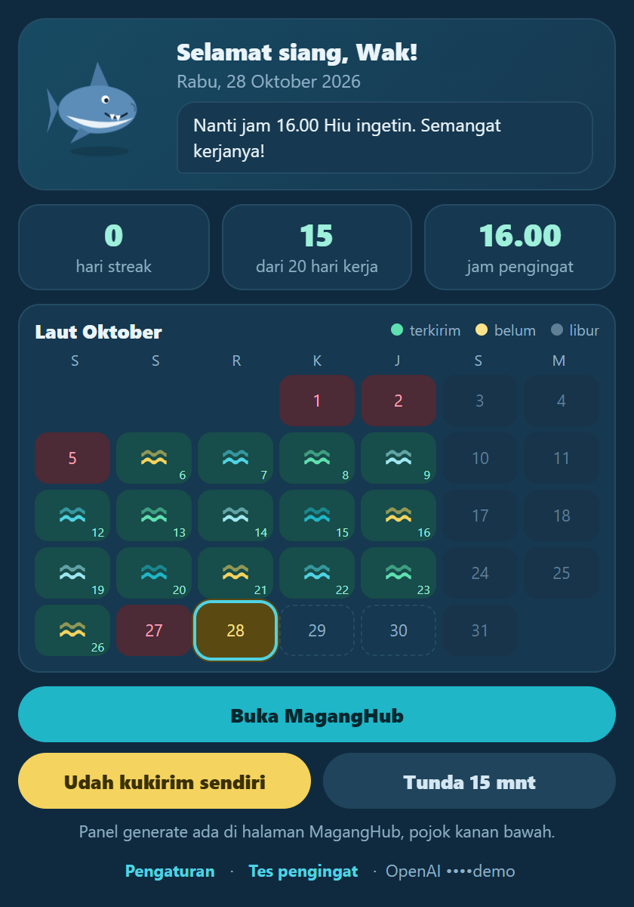 | 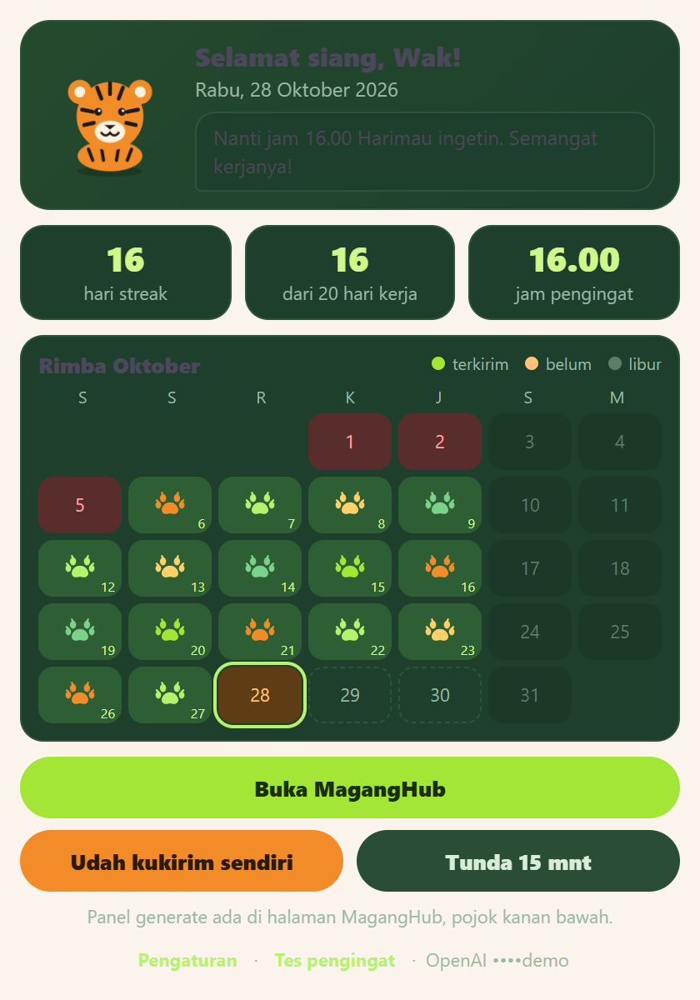 |

| Tema | Nuansa | Maskot |
|---|---|---|
| **Sore** (default) | senja plum gelap, amber, koral | matahari terbenam |
| Simpel | netral abu hangat, tanpa maskot | lingkaran status |
| Bara | arang hitam, oranye bara | api kecil |
| Robo | slate gelap, mint neon | robot |
| Astro | navy pekat, biru langit | astronot |
| Baro si beruang | kayu gelap, hijau daun, madu | beruang |
| Hiu | navy laut, teal, kuning | hiu |
| Harimau | hutan gelap, lime | harimau belang |
| Tegas | hitam dan kuning safety | lingkaran status |
| Sawit, Momo si kucing, Kaktus | pastel terang | pohon sawit, kucing, kaktus |

Tiap tema punya palet sendiri, versi mode malam, ikon kalender sendiri (matahari, api, ombak, petir, bintang, cap kaki, bunga), chime bawaan, dan empat ekspresi maskot: senang, gelisah, layu, tidur.

| Pengaturan | Panduan pertama kali |
|---|---|
| 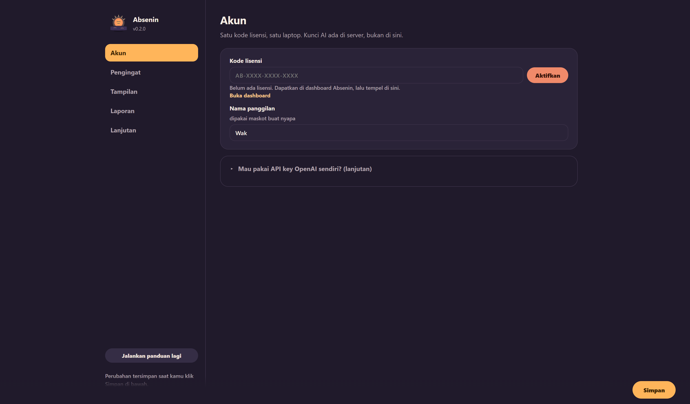 | 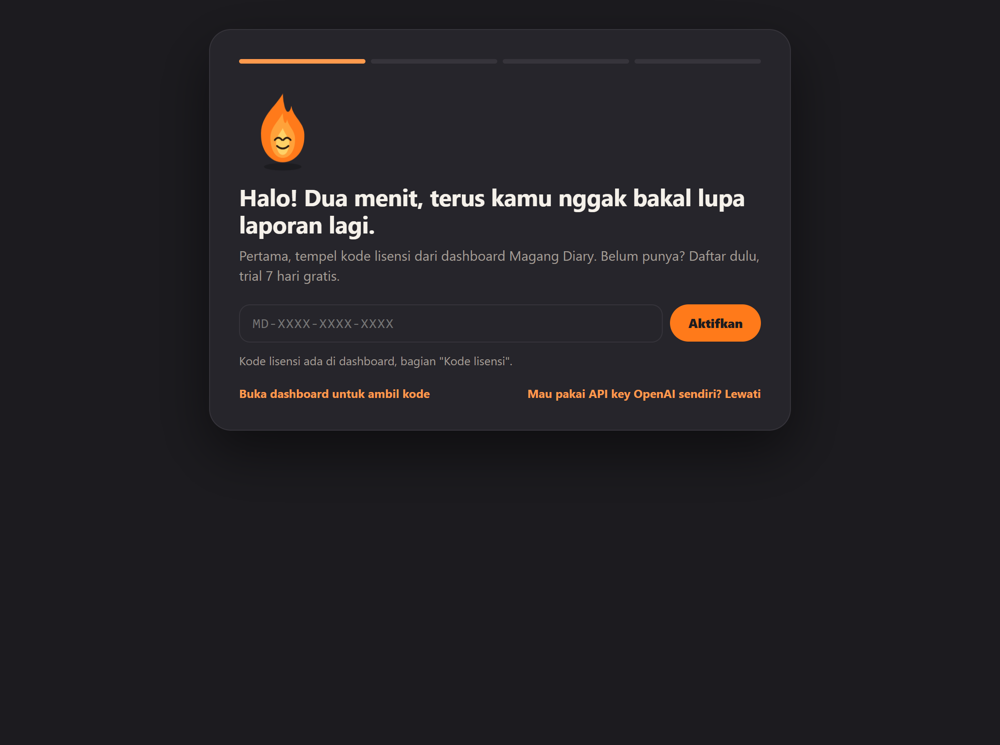 |

## Pasang ekstensi

1. Unduh zip dari dashboard (atau pakai folder `extension/` repo ini).
2. Buka `chrome://extensions`, nyalakan **Developer mode**, klik **Load unpacked**, pilih folder `extension`.
3. Tab panduan terbuka otomatis: tempel kode lisensi dari dashboard, pilih maskot, set jam, tes pengingat.
4. Buka halaman Riwayat MagangHub satu kali supaya status hari ini terbaca.

Opsional, supaya pengingat tetap jalan saat Chrome ditutup: klik kanan `extension/scheduler/pasang-task.ps1`, pilih **Run with PowerShell**. Untuk jam lain: `.\pasang-task.ps1 -Jam "15:30"`. Lepas dengan `hapus-task.ps1`.

Mode lanjutan: di Pengaturan > Akun, bagian terlipat "Pakai API key OpenAI sendiri" menjalankan generate langsung dari laptop tanpa server.

## Jalankan web

Web berisi landing page, dashboard pengguna, admin, dan API proxy yang memegang kunci OpenAI. Semua autentikasi dan data lewat Supabase.

| Landing (terang) | Login |
|---|---|
| 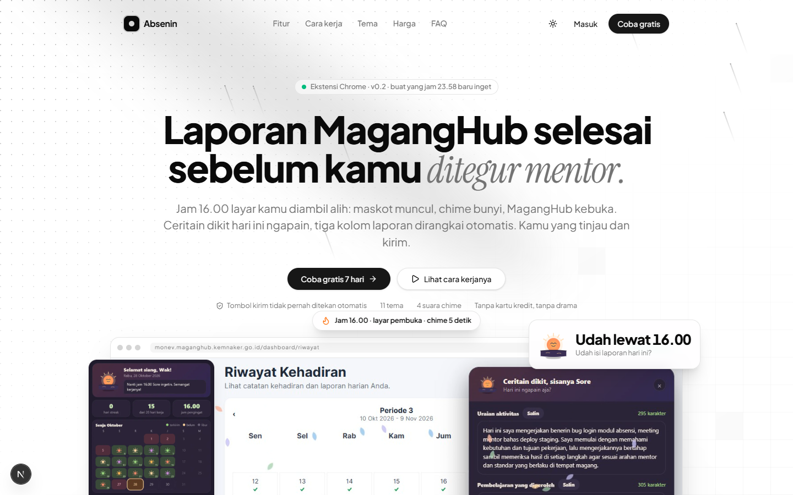 | 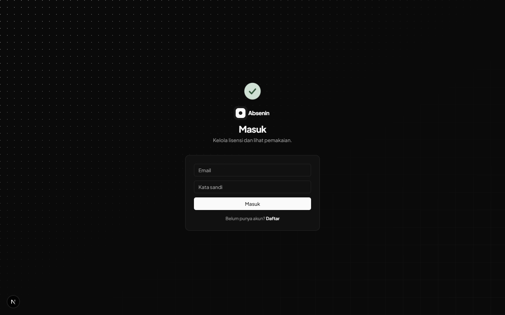 |

### 1. Supabase

1. Buat project Supabase sendiri.
2. Buka SQL Editor, tempel isi [`supabase/schema.sql`](supabase/schema.sql), klik Run. Ini membuat tabel `profiles`, `licenses`, `usage_log`, `remote_config`, `telemetry`, `beta_signups`, trigger pembuatan profil, dan RLS.
3. Authentication > Providers > Email: kalau **Confirm email** aktif, pendaftar harus klik tautan di email dulu (halaman daftar sudah menanganinya). Matikan kalau mau langsung masuk.

### 2. Env

Salin `.env.example` ke `.env.local`:

```env
NEXT_PUBLIC_SUPABASE_URL=https://xxxx.supabase.co
NEXT_PUBLIC_SUPABASE_ANON_KEY=...
SUPABASE_SERVICE_ROLE_KEY=...        # hanya server, tidak pernah ke browser atau ekstensi
OPENAI_API_KEY=sk-...                # hanya server
OPENAI_MODEL=gpt-4o-mini
NEXT_PUBLIC_SITE_URL=http://localhost:3000
```

Tanpa `OPENAI_API_KEY`, generate memakai template cadangan yang ditandai `offline`, jadi seluruh alur bisa dites tanpa biaya.

### 3. Jalankan

```bash
npm install
npx playwright install chromium                 # sekali, untuk screenshot dan verifikasi
npm run admin -- email@kamu.id kata-sandi-kuat  # admin pertama: user Supabase Auth + role admin
npm run dev                                     # http://localhost:3000
npm run verify                                  # uji end-to-end: login, trial, aktivasi, generate, admin, dashboard
```

| Perintah | Fungsi |
|---|---|
| `npm run dev` / `build` / `start` | Next.js |
| `npm run admin -- email [sandi]` | Buat atau naikkan user Supabase Auth jadi admin |
| `npm run verify` | Buat user tes terkonfirmasi, uji seluruh alur, screenshot ke `.verify/`, bersihkan |
| `npm run shots` | Screenshot ekstensi asli (Chromium + ekstensi unpacked + halaman MagangHub tiruan) ke `public/shots` |
| `npm run demo` | Rekam video demo `public/demo.webm` dari ekstensi asli |
| `npm run pack` | Bungkus `extension/` jadi `public/downloads/absenin.zip` dan sinkron `extension/shared` ke `public/ext` (otomatis saat build) |

Semua skrip punya pemeriksaan awal: kalau skema Supabase belum dipasang, pesannya langsung menunjukkan langkahnya.

### Halaman

| Rute | Isi |
|---|---|
| `/` | Landing: hero dengan video demo asli, fitur, cara kerja (kartu bertumpuk), galeri tema horizontal, panggung tema interaktif, harga, beta tester, FAQ |
| `/daftar`, `/login` | Supabase Auth |
| `/dashboard` | Kode lisensi (sembunyi/salin), kuota harian, perangkat, aktivasi trial, cara pasang, pemakaian terakhir, peringatan pindah perangkat |
| `/admin` | KPI, grafik 14 hari, buat lisensi, tabel lisensi (perpanjang, lepas perangkat, cabut), pengguna dan role, log pemakaian, telemetri ekstensi, pendaftar beta, konfigurasi jarak jauh (model, kuota, pengumuman, versi minimum, instruksi AI) |
| `/checkout` | Placeholder pembayaran |
| `/blog` | Artikel panduan laporan MagangHub (pintu masuk SEO) |
| `/syarat`, `/privasi` | Syarat layanan, refund 7 hari, kebijakan privasi |

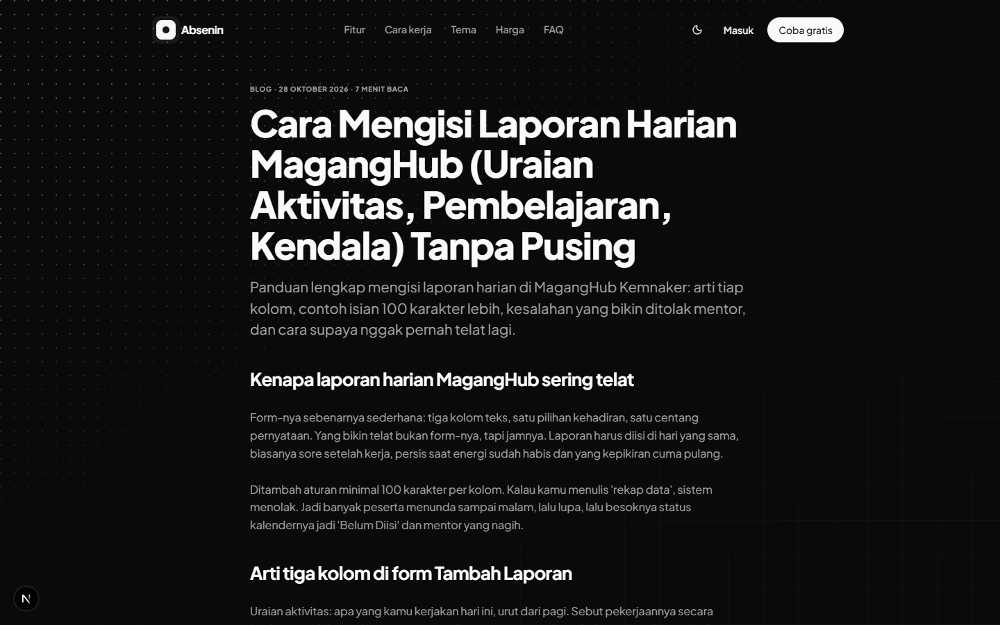

## Arsitektur

```
extension/                 Ekstensi Chrome, Manifest V3
├── manifest.json
├── background.js          alarm harian, notifikasi, buka tab fullscreen, proxy ke server, telemetri, badge
├── content/content.js     deteksi status kalender, panel cerita, isi form, Alt+M
├── popup/                 buku harian: maskot, kebun bulanan, streak
├── options/               pengaturan 5 tab
├── onboarding/            panduan pertama kali
├── splash/                layar pembuka + chime
├── shared/                util, gaya laporan, 12 tema + maskot, chime, idle
├── scheduler/             Task Scheduler Windows
└── icons/

src/                       Web, Next.js 16 App Router + Tailwind v4 + GSAP + Lenis
├── app/
│   ├── page.tsx           landing
│   ├── dashboard/ admin/ login/ daftar/ checkout/ blog/ syarat/ privasi/
│   ├── api/               generate, license, config, auth, me, admin, telemetry, beta
│   ├── sitemap.ts robots.ts opengraph-image.tsx
│   └── globals.css        style kit p441z + skala tipografi phi
├── components/            landing, app, effects (GSAP), ui
└── lib/                   env, db (Supabase), auth, generate (prompt), license, ratelimit, blog, site

supabase/schema.sql        skema + trigger + RLS
scripts/                   Playwright: shots, demo, verify; pack; make-admin; helper supa
public/shots, demo.webm    aset landing, dibuat dari ekstensi asli
```

**Alur generate:** ekstensi mengirim cerita singkat + gaya + 3 laporan terakhir ke `POST /api/generate` dengan `Authorization: Bearer <kode lisensi>`. Server memeriksa pembatas laju, lisensi, kuota harian, versi minimum ekstensi, lalu memanggil OpenAI dengan prompt yang menganggap teks pengguna sebagai data, bukan instruksi. Hasil dicatat ke `usage_log` (jumlah token, status), isi laporan tidak disimpan.

**Ikatan perangkat:** satu lisensi, satu perangkat aktif. Pindah perangkat diizinkan, dicatat sebagai `device-change`, dan ditampilkan di dashboard selama 7 hari.

**Konfigurasi jarak jauh:** admin bisa mengganti model, kuota default, pengumuman, versi minimum ekstensi, dan instruksi tambahan untuk AI tanpa merilis ulang ekstensi.

## API

| Endpoint | Auth | Fungsi |
|---|---|---|
| `POST /api/license/activate` | body `key`, `deviceId`, `version` | Verifikasi lisensi, ikat perangkat, kembalikan paket, masa berlaku, kuota, `updateRequired` |
| `GET /api/license/status` | `Bearer <key>` | Sisa kuota hari ini |
| `POST /api/generate` | `Bearer <key>`, header `X-Extension-Version` | Proxy OpenAI dengan cek lisensi, kuota, versi |
| `GET /api/config` | - | Pengumuman, versi minimum, kuota default |
| `POST /api/telemetry` | `Bearer <key>` opsional | Kejadian anonim dari ekstensi |
| `POST /api/beta`, `GET /api/beta` | - | Daftar beta tester, statistik publik |
| `POST /api/auth/login`, `register`, `logout` | - | Supabase Auth lewat cookie |
| `POST /api/me/trial` | cookie | Lisensi trial 7 hari |
| `POST /api/admin/licenses`, `PATCH` | cookie admin | Buat, perpanjang, lepas perangkat, cabut |
| `POST /api/admin/config`, `PATCH /api/admin/users` | cookie admin | Konfigurasi jarak jauh, role |

## Keamanan

- Kunci OpenAI dan service role Supabase hanya ada di env server. Ekstensi memegang kode lisensi saja.
- Pembatas laju per IP di memori proses: login 10/10 menit, daftar 5/jam, trial 3/jam, aktivasi 20/10 menit, generate 30/10 menit. Pindahkan ke Redis kalau jalan di beberapa instance.
- RLS aktif di semua tabel; pengguna hanya bisa membaca datanya sendiri lewat anon key, server memakai service role.
- Riwayat Chrome dibaca di laptop pengguna; hanya satu kalimat rangkuman yang mungkin terkirim, dan pengguna melihatnya dulu.
- Ekstensi tidak pernah menekan Simpan dan Kirim, tidak membaca halaman selain `monev.maganghub.kemnaker.go.id`, dan tidak mengubah data di MagangHub.

## SEO

Metadata lengkap dengan kata kunci "laporan harian MagangHub", gambar Open Graph otomatis, `sitemap.xml`, `robots.txt`, JSON-LD `SoftwareApplication` + `FAQPage` di landing dan `Article` + `FAQPage` di blog. Tambah artikel dengan menambah entri di `src/lib/blog.ts`.

## Yang belum

- Gerbang pembayaran (Midtrans atau Xendit). Checkout masih mengarahkan ke aktivasi manual oleh admin.
- Email transaksional (kirim kode lisensi, pengingat lisensi habis).
- Deploy dan domain. Setelah ada, ganti `apiBase` bawaan di `extension/shared/util.js` dan `host_permissions` di manifest.
- Mac dan Linux: Task Scheduler hanya Windows.

## Lisensi

Kode di repo ini milik pembuatnya. Pemakaian produk tunduk pada halaman Syarat Layanan di web.
